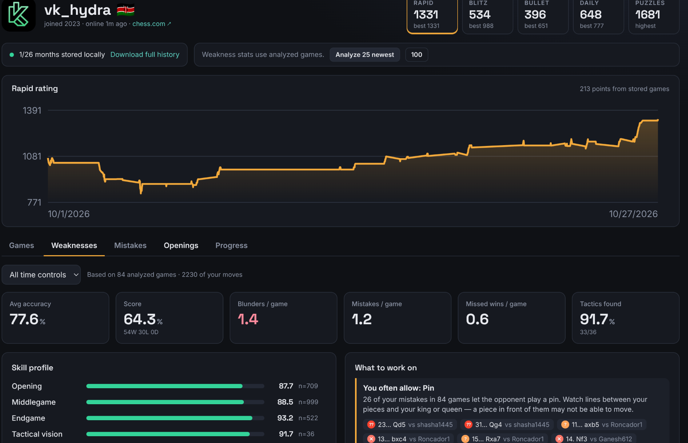
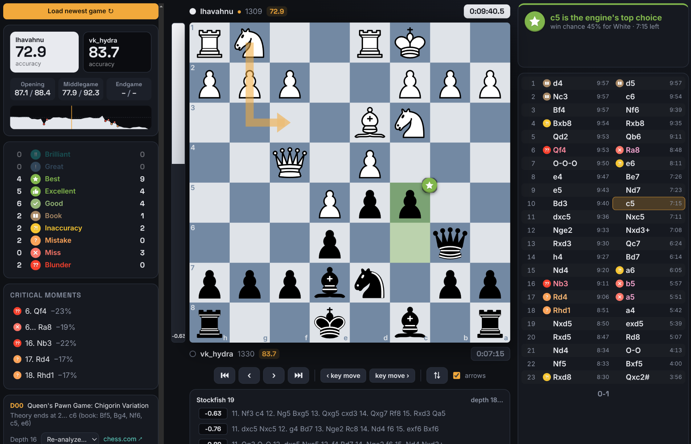

# BlunderLens

BlunderLens reviews your Chess.com games with Stockfish 19 and shows you the mistakes you keep making.

Type a Chess.com username to see your ratings and games. Every game gets a full review: accuracy, move ratings from Brilliant to Blunder, an eval graph, and a short note on each mistake explaining what you missed. Across many games it finds your weak spots, such as the tactics you keep allowing, the phase where you lose points, and how you play under time pressure. There is also a live board for studying positions.





## Online vs. local

**Online:** [chess-bice-gamma.vercel.app](https://chess-bice-gamma.vercel.app). Nothing to install. Stockfish runs inside your browser as a smaller, single-threaded version, so a review takes about a minute per game. Nothing is saved, so your games are gone when you close the tab. The live board is not available online.

**Local:** runs the full native Stockfish 19 on all your CPU cores, so reviews are much faster and deeper. Games and reviews are saved in a local database, so they are only downloaded and analysed once. It includes the live board.

```bash
npm install
npm run dev        # open http://localhost:5173
```

You need Node 24+ and the Stockfish binary at `engine/stockfish/stockfish-linux-x86-64-universal` (or set `STOCKFISH_PATH`).

*Use the live board only for study, never during a rated game. That is engine assistance and breaks Chess.com's fair-play rules.*
